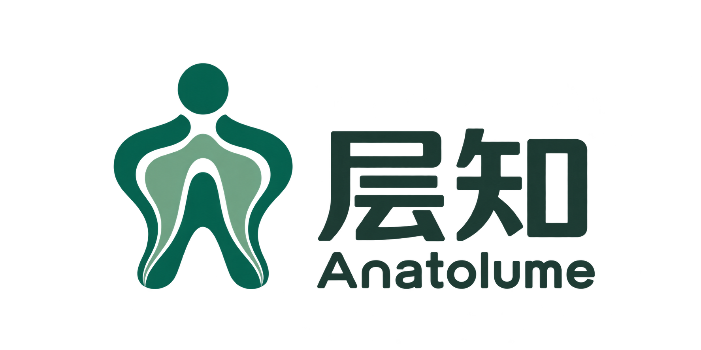
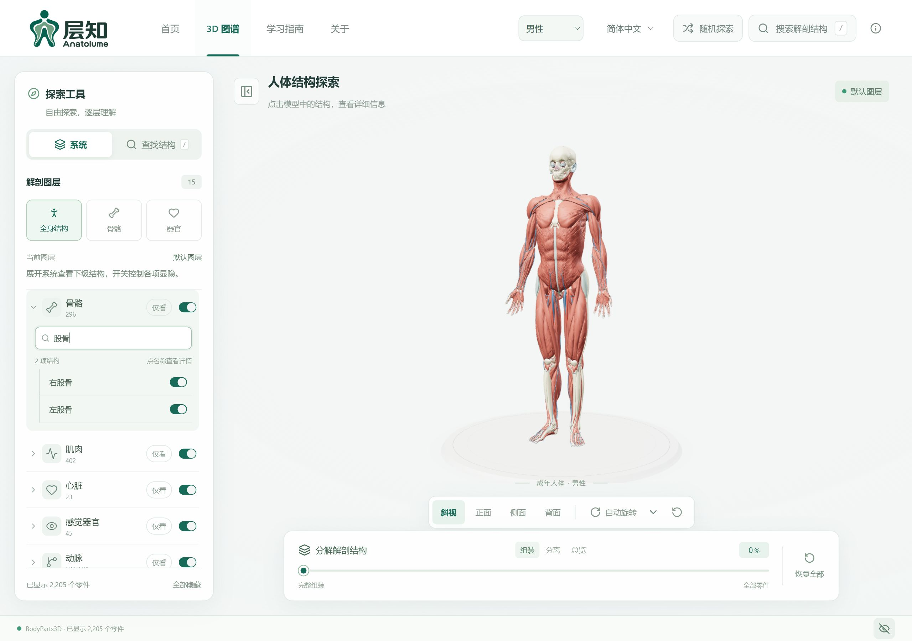
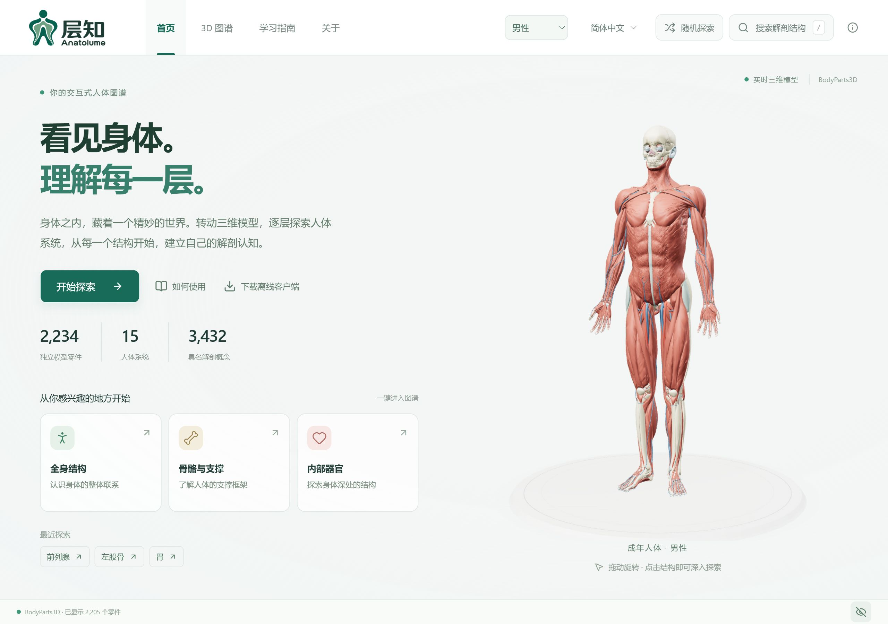
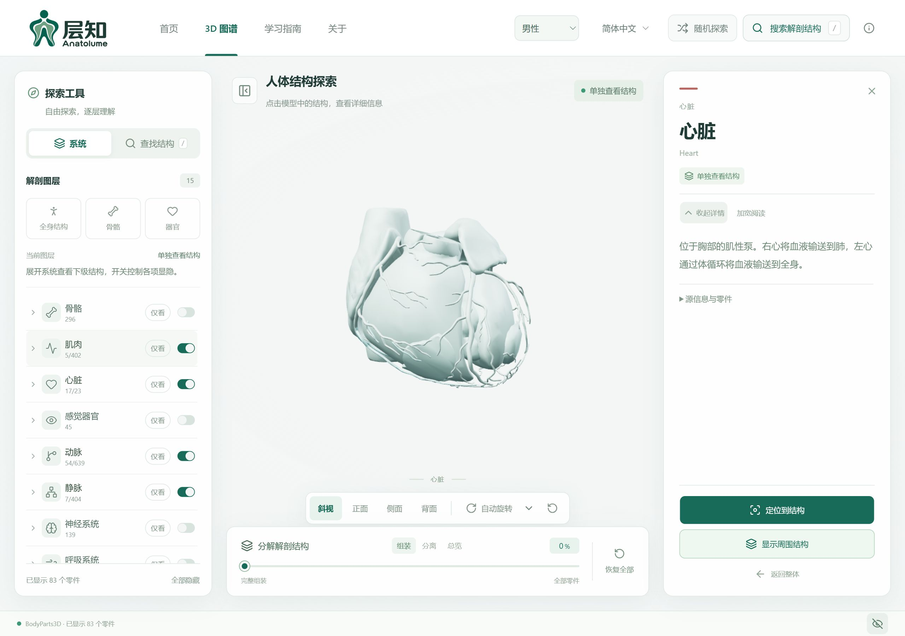

<a name="readme-top"></a>

<div align="center">



# 层知 · Anatolume

**看见身体，理解每一层。**<br>
*See the body. Understand every layer.*

三维人体图谱 · 网页探索与离线客户端<br>
Interactive 3D anatomy · Web and offline desktop

应用语言 / App languages：简体中文 · English · Español · 日本語 · 한국어

[**简体中文**](#简体中文) · [**English**](#english) · [界面预览 / Preview](#preview)

[](#开始使用)
[](https://github.com/isunky/Anatolume/actions/workflows/ci.yml)
[](LICENSE)
[](public/ATTRIBUTION.md)

<p align="center">
  <a href="https://isunky.github.io/Anatolume/" target="_blank" rel="noopener noreferrer"></a>
  &nbsp;&nbsp;
  <a href="https://anatolume.sunky.net/" target="_blank" rel="noopener noreferrer"></a>
</p>

[**下载离线客户端 / Download offline client**](https://github.com/isunky/Anatolume/releases)

</div>

<a name="preview"></a>

## 界面预览 · Preview

系统列表、三维观察和结构介绍集中在同一个探索界面。展开系统可筛选下级结构并控制显隐，选中器官后可在单独观察与周围视图之间切换。

Browse systems, inspect the model and read structure details in one workspace. Switch between an isolated organ and its surroundings.

[](docs/screenshots/explorer.jpg)

<details>
<summary><strong>更多界面 / More screenshots</strong> · 首页、女性模型、结构详情、分离模式与手机端</summary>

### 首页 · Home

从全身、骨骼、器官开始探索，也可通过右上角“随机探索”发现一个完整器官。

Start with the full body, bones or organs, or discover a complete organ with Random exploration.

[](docs/screenshots/home.jpg)

### 女性学习模型 · Female study model

页眉切换模型，探索乳腺及女性生殖结构。

Switch models in the header to explore breast tissue and female reproductive structures.

[](docs/screenshots/female.jpg)

### 结构详情 · Structure details

单独查看目标，或平滑定位回周围视图，理解结构的位置关系。

Isolate a target or smoothly locate it in its surroundings.

[](docs/screenshots/structure-detail.jpg)

### 系统分离 · System separation

主要系统按实际宽度紧凑排开，保留内部关系；继续拖动滑条进入零件总览。

Systems are arranged compactly while preserving internal relationships; move the slider further for a parts overview.

[](docs/screenshots/separated.jpg)

### 手机端 · Mobile

<p align="center">
  <a href="docs/screenshots/home-mobile.jpg"></a>
</p>

</details>

<sub>真实应用截图，采集于 2026-10-12。桌面原图 2560 × 1800，手机 390 × 844；保留浏览器原始 JPEG 输出，点击可查看高清原图。在线站点和安装包以各自版本为准。</sub>

<sub>Actual app screenshots captured on 2026-10-12, with the Chinese interface; English is also supported. Desktop: 2560 × 1800. Mobile: 390 × 844. Click images for the original JPEG files. Deployed sites and releases may show different versions.</sub>

---

## 简体中文

[English ↓](#english) · [界面预览 ↑](#preview)

[核心功能](#核心功能) · [开始使用](#开始使用) · [模型与许可](#模型与许可) · [开发与构建](#开发与构建) · [文档导航](#文档导航) · [开源致谢](#开源致谢)

层知将人体结构变成可以旋转、分层、拆解和搜索的学习空间。从全身关系出发探索骨骼、肌肉与器官，也可以直接找到一个结构，单独观察并阅读介绍。无需账号；网页打开即用，桌面客户端随包提供男女两套模型，支持离线探索。

### 核心功能

| 探索方式 | 体验 |
| --- | --- |
| **男女模型** | 页眉切换男性参考模型与女性学习模型，分别保存最近浏览记录。 |
| **分层浏览** | 全身、骨骼、器官视图；展开系统、筛选下级结构、逐项显隐或仅看某个系统。 |
| **多语言搜索** | 中文、英文、西班牙语、日语、韩语界面；使用已收录译名、别名或源 ID 搜索，支持重音省略和全角 ID。 |
| **结构聚焦** | 单独观察并阅读介绍；平滑定位至周围视图并高亮目标，或在详情中隐藏当前结构。 |
| **镜头与旋转** | 平滑切换斜视、正面、侧面与背面；自动旋转支持方向和连续速度调节。 |
| **随机探索** | 右上角入口随机选择完整器官并聚焦；详情中“再换一个”可继续探索。 |
| **隐私模式** | 默认视图与随机探索隐藏敏感结构；主动搜索或从列表打开系统、部件仍可查看。 |
| **拆解观察** | 从完整人体过渡到紧凑系统分离，再进入零件总览。 |
| **离线与更新** | 桌面模型随包提供；本机保存偏好与记录，客户端支持检查并安装新版。 |

### 开始使用

**在线：** 打开 [GitHub Pages](https://isunky.github.io/Anatolume/) 或 [Cloudflare Pages](https://anatolume.sunky.net/)，选择模型和探索入口。

**离线：** 前往 [GitHub Releases](https://github.com/isunky/Anatolume/releases)，选择适合的发布文件。

| 版本 | 文件 | 使用方式 |
| --- | --- | --- |
| Windows x64 安装版 | `Anatolume_<版本号>_x64-setup.exe` | 安装后从开始菜单启动。 |
| Windows x64 便携版 | `Anatolume_<版本号>_Windows-x64-portable.zip` | 解压后运行 `Anatolume.exe`。 |
| macOS 通用版 | `Anatolume_<版本号>_macOS-universal.dmg` | macOS 11+，支持 Intel 与 Apple Silicon。 |
| Web 部署包 | `Anatolume_<版本号>_Web.zip` | 包含页面与模型，通过 HTTP/HTTPS 部署。 |

手机可直接使用网页版，目前没有 Android 安装包。历史版本可能使用应用更名前的文件名。

<details>
<summary><strong>安装、离线与自动更新说明</strong></summary>

- **Windows：** 需要 WebView2。安装程序在缺少运行时时联网下载；便携版需预先安装运行时。当前程序没有 Authenticode 签名，系统可能提示未知发布者。
- **macOS：** 建议从源码自行构建。自动生成的 DMG 使用 ad-hoc 签名，未经 Apple 公证；首次启动可能需要在系统安全设置中允许。
- **离线范围：** 客户端内含两套模型；外部来源、参考资料和更新下载需要联网。语言、模型偏好与最近浏览记录保存在本机。
- **自动更新：** 启动检查正式版，在“关于与致谢 → 应用更新”可查看更新内容、手动检查、下载并安装。离线或检查失败不影响探索。
- **更新包：** 安装版、便携版与 macOS 使用对应的签名更新包；应用内签名不替代操作系统代码签名。旧客户端需先手动安装首个支持更新的版本。
- **校验：** 发布提供 `SHA256SUMS` 和 `BUILD-REPORT.md`。完整更新与构建说明见 [发布指南](docs/RELEASE.md)。

</details>

<details>
<summary><strong>操作与快捷键</strong></summary>

| 操作 | 方法 |
| --- | --- |
| 旋转／缩放 | 拖动模型／滚轮或双指缩放。 |
| 查看结构 | 点击模型、搜索结果或列表中的结构。 |
| 搜索 | 点击搜索入口；非输入状态按 `/`。 |
| 选择搜索结果 | `↑`／`↓` 移动，`Enter` 选择，`Esc` 退出。 |
| 对照位置 | “显示周围结构”；“定位到结构”平滑定位并高亮目标。 |
| 隐藏当前结构 | 在结构详情中点击“隐藏当前结构”；关闭详情并保留其他结构的显示设置，可从列表重新显示。 |
| 继续随机探索 | 右上角“随机探索”，或详情中的“再换一个”。 |
| 自动旋转设置 | 打开按钮旁下拉框，选择方向并拖动速度滑条；100% 为最高速度。 |
| 隐私设置 | 点击底部隐私图标进入设置；鼠标悬浮查看当前状态解释。 |
| 恢复默认 | 点击底部“恢复全部”。 |

左右均以**人体自身**为准。更多说明见 [客户端文档](client/README.md)。

</details>

<details>
<summary><strong>常见问题</strong></summary>

| 情况 | 排查方法 |
| --- | --- |
| 客户端窗口空白 | 检查 WebView2 与显卡驱动，重新启动。 |
| 模型加载失败 | 网页检查网络和资源；客户端尝试重新启动或安装。 |
| 看不到内部器官 | 搜索后单独查看，或隐藏遮挡的外层系统。 |
| 卸载 Windows 客户端 | 在系统“已安装的应用”中卸载。 |

</details>

### 模型与许可

新增三种语言已覆盖界面、系统名称与概述、常见器官和主要骨骼；细分结构尚未全量翻译，未核对的名称保留英文。译文尚未经独立专业审校。范围、参考来源与维护规则见 [多语言与术语说明](docs/LOCALIZATION.md)。

| 模型 | 独立网格 | 系统／图层 | 具名概念 |
| --- | ---: | ---: | ---: |
| 男性参考模型 | 2,234 | 15 | 3,432 |
| 女性实验性学习模型 | 2,245 | 16 | 4,248 |

女性模型基于 BodyParts3D 与 HRA 数据，经 Human Atlas Enhanced 改编；比例和位置为估算，尚未经独立解剖审校。范围与来源见 [女性模型指南](docs/FEMALE_MODEL.md)。

| 内容 | 许可 |
| --- | --- |
| 应用代码 | [MIT](LICENSE)，保留原作者版权与许可声明。 |
| 解剖模型与源数据 | **CC BY 4.0**，保留 BodyParts3D、HRA 的原作者、来源与改编记录，详见 [ATTRIBUTION.md](public/ATTRIBUTION.md)。 |
| 第三方依赖 | 遵循各自许可证。 |

> 用于解剖学习与探索，不用于诊断、手术规划或临床决策。模型不能代表所有结构与个体差异；中文术语和新增学习说明尚未经医学专家审校。

<details>
<summary><strong>数据范围与处理记录</strong></summary>

- 一个概念可包含多个模型零件，概念数量不等于可独立显示的网格数量。
- 女性模型包含女性生殖器官与独立乳房组织图层，仍缺少女性外部皮肤、生殖器外表面及已验证的女性尿道／盆底替代结构。
- 男性含 2,288,268 个三角形，压缩几何约 33 MB；女性含 2,437,148 个三角形，约 35 MB。模型处理采用每结构 0.2% 相对误差上限，女性保留上游几何、改编及校验记录。
- 中文术语覆盖两套模型的 5,172 个唯一源名称，属于规则生成并补充常见词组的待审校草稿；保留英文原名与源 ID 供核对。
- 结构说明区分具体器官解释与一般系统概述；维护方式见 [中文术语审校](client/README.md#中文术语审校)。

</details>

### 开发与构建

React · TypeScript · Three.js · Tauri · Vite。网页和客户端共享交互与渲染逻辑，仓库已包含模型，普通运行无需重新转换数据。

需要 **Node.js 22.18+**；仓库 `.node-version` 指定 Node 24。

```sh
git clone https://github.com/isunky/Anatolume.git
cd Anatolume
npm ci
npm run dev
```

开发地址：<http://127.0.0.1:3016/>，默认仅绑定本机。

| 命令 | 用途 |
| --- | --- |
| `npm run build` | Web 构建，输出 `dist/`。 |
| `npm run build:pages` | Cloudflare Pages 专用构建及资源验证。 |
| `npm run build:client` | 客户端前端，输出 `dist-client/`。 |
| `npm run client:dev` | 启动桌面开发模式。 |
| `npm run client:build` | Windows x64 NSIS 安装包。 |
| `npm run client:build:mac` | 在 macOS 构建通用 DMG。 |
| `npm run ci:check` | 类型、双语、模型、交互及构建检查。 |
| `npm run validate:release` | 版本与发布流程校验。 |

Windows 原生构建需要 Rust MSVC、Visual Studio C++ Build Tools、Windows SDK 与 WebView2。本地不生成签名更新包时，使用 `npm run client:build -- --config src-tauri/tauri.local.conf.json`；macOS 使用同样配置参数。详情见 [发布签名说明](docs/RELEASE.md#发布签名密钥)。

#### 部署与发布

- **静态部署：** `dist/` 支持根目录和子目录；Web ZIP 需通过 HTTP/HTTPS 服务访问。Vercel 配置见 [vercel.json](vercel.json)。
- **Cloudflare Pages：** 连接仓库的 `main`，构建命令 `npm ci && npm run build:pages`，输出 `dist`，环境变量 `SKIP_DEPENDENCY_INSTALL=1`。详见 [配置指南](docs/CLOUDFLARE_PAGES.md)。
- **CI：** 提交／PR 自动运行检查以及 Web、Pages、客户端前端构建，不修改版本、不创建 Release。
- **手动发布：** 选择 `patch / minor / major`，自动同步版本、构建全部平台、签名更新包、发布 Release 并部署 GitHub Pages。更新说明直接摘要本次变更；`0.x` 标为预发布，`1.x` 起为正式版。

### 文档导航

| 文档 | 内容 |
| --- | --- |
| [产品需求 PRD](docs/PRD.md) | 已有体验、后续视觉方案与暂缓的性能优化。 |
| [客户端开发](client/README.md) | 运行、平台桥接与术语维护。 |
| [项目结构与 CI](docs/PROJECT_STRUCTURE.md) | 模块划分、渲染和检查流程。 |
| [发布与更新](docs/RELEASE.md) | 自动版本、全平台发布、签名与故障重试。 |
| [Cloudflare Pages](docs/CLOUDFLARE_PAGES.md) | 连接 GitHub 构建及部署。 |
| [女性模型](docs/FEMALE_MODEL.md) | 数据范围、导入与验证。 |
| [多语言与术语](docs/LOCALIZATION.md) | 五语言范围、命名与别名规则、英文兜底及参考来源。 |
| [品牌资源](docs/branding/README.md) | 完整 logo、原稿与压缩资源。 |
| [数据署名](public/ATTRIBUTION.md) | 权利声明、许可与改编记录。 |

后续方案以 PRD 的状态为准；尚未实施的外观配置和性能优化不属于当前功能。

### 参与贡献

欢迎提交 [Issue](https://github.com/isunky/Anatolume/issues) 或 [Pull request](https://github.com/isunky/Anatolume/pulls)。交互问题请附复现步骤与运行环境；术语修正请附源 ID、建议名称和参考来源。

代码提交前运行 `npm run ci:check`；涉及 Rust 时检查格式，界面变更同步截图。浏览器已覆盖桌面与多种手机视口，真实手机性能和多指操作仍需设备验证。

模型处理流程见 [项目结构](docs/PROJECT_STRUCTURE.md) 与 [`convert-anatomy.py`](scripts/convert-anatomy.py)、[`optimize-anatomy.mjs`](scripts/optimize-anatomy.mjs)、[`compress-models.mjs`](scripts/compress-models.mjs)。

### 开源致谢

层知基于开源代码和开放解剖数据继续开发。感谢原作者、数据贡献者及工具维护者。

- **代码基础：** 感谢 [ashemag](https://github.com/ashemag) 的 [Human Atlas](https://github.com/ashemag/human-atlas)。本项目继续完善双语、探索交互与离线客户端，保留原项目的 MIT 版权和许可声明。
- **BodyParts3D：** 感谢 [The Database Center for Life Science](https://dbarchive.biosciencedbc.jp/en/bodyparts3d/download.html) 提供模型、英文名称与结构关系，采用 [CC BY 4.0](https://creativecommons.org/licenses/by/4.0/)。
- **女性衍生模型：** 感谢 [PrejudiceNeutrino](https://github.com/PrejudiceNeutrino) 分享 [Human Atlas Enhanced](https://github.com/PrejudiceNeutrino/human-atlas-enhanced) 及改编记录；本仓库保留其源标识、几何与配准记录。
- **HRA／HuBMAP：** 感谢 Kristen Browne、Heidi Schlehlein 与 Human Reference Atlas／HuBMAP 提供 *3D Reference Organ Set for Female v1.5*（2023，[DOI](https://doi.org/10.48539/HBM352.BTSQ.586)），源数据采用 CC BY 4.0。完整署名与改编信息见 [ATTRIBUTION.md](public/ATTRIBUTION.md)。

> BodyParts3D, © The Database Center for Life Science licensed under CC Attribution 4.0 International.

感谢 [React](https://react.dev/)、[Three.js](https://threejs.org/)、[Tauri](https://tauri.app/)、[Vite](https://vite.dev/)、[Tailwind CSS](https://tailwindcss.com/)、[Base UI](https://base-ui.com/)、[Lucide](https://lucide.dev/)、[meshoptimizer](https://github.com/zeux/meshoptimizer)，以及参与反馈和改进的社区贡献者。

[English ↓](#english) · [返回顶部 ↑](#readme-top)

---

## English

[简体中文 ↑](#简体中文) · [Preview ↑](#preview)

[Features](#features) · [Get started](#get-started) · [Models & licensing](#models-and-licensing) · [Development](#development) · [Documentation](#documentation) · [Acknowledgements](#acknowledgements)

Anatolume turns human anatomy into a space for rotating, revealing layers, separating systems and searching structures. Explore bones, muscles and organs in context, or isolate a structure and read its introduction. No account is required. Use the web app directly, or explore offline with both models included in the desktop client.

### Features

| Explore | Experience |
| --- | --- |
| **Male and female models** | Switch between the male reference and female study model, with separate recent browsing histories. |
| **Layers and structures** | Full-body, bones and organs views; expand systems, filter structures, toggle individual items or show one system only. |
| **Multilingual search** | Chinese, English, Spanish, Japanese and Korean interfaces; search available translated names, aliases or source IDs, including accent-insensitive and full-width input. |
| **Structure focus** | Isolate a structure and read its introduction; smoothly locate it in context, or hide the current structure from its details panel. |
| **Camera and rotation** | Smooth transitions between oblique, front, side and back views; auto-rotation with direction and continuous speed controls. |
| **Random exploration** | Discover and focus on a complete organ; use “Another organ” in the details panel to continue. |
| **Privacy mode** | Hide sensitive structures in default views and random exploration; explicit searches and system or structure selections still allow viewing. |
| **Separation** | Transition from the assembled body to compact system separation and then a parts overview. |
| **Offline and updates** | Desktop models are bundled; preferences and history stay local, with checks and installation for newer releases. |

### Get started

**Online:** Open [GitHub Pages](https://isunky.github.io/Anatolume/) or [Cloudflare Pages](https://anatolume.sunky.net/), select a model and start exploring.

**Offline:** Choose a release asset from [GitHub Releases](https://github.com/isunky/Anatolume/releases).

| Edition | File | Usage |
| --- | --- | --- |
| Windows x64 installer | `Anatolume_<version>_x64-setup.exe` | Install, then launch from the Start menu. |
| Windows x64 portable | `Anatolume_<version>_Windows-x64-portable.zip` | Extract and run `Anatolume.exe`. |
| macOS universal | `Anatolume_<version>_macOS-universal.dmg` | macOS 11+, for Intel and Apple Silicon. |
| Web deployment | `Anatolume_<version>_Web.zip` | Includes pages and models; serve over HTTP/HTTPS. |

Phones can use the web app; no Android package is currently provided. Older releases may use the application's previous name.

<details>
<summary><strong>Installation, offline use and automatic updates</strong></summary>

- **Windows:** WebView2 is required. The installer downloads the runtime if missing; the portable edition requires it to be installed beforehand. The app currently has no Authenticode signature, so Windows may show an unknown publisher warning.
- **macOS:** Building from source is recommended. Generated DMGs use ad-hoc signing and are not Apple-notarized; first launch may require permission in system security settings.
- **Offline scope:** Both models are bundled. External sources, references and update downloads need a connection. Language, model preferences and recent history are stored locally.
- **Automatic updates:** The client checks for stable releases at startup. In About & acknowledgements → App updates, read changes, check manually, download and install. Offline or failed checks do not block exploration.
- **Update packages:** Installer, portable and macOS editions use their respective signed packages. Update signatures do not replace operating-system code signing. Older clients first need a manual installation of a version that supports updates.
- **Verification:** Releases include `SHA256SUMS` and `BUILD-REPORT.md`. See the [release guide](docs/RELEASE.md) for update and build details.

</details>

<details>
<summary><strong>Controls and shortcuts</strong></summary>

| Action | How |
| --- | --- |
| Rotate / zoom | Drag the model / use the wheel or pinch gesture. |
| Inspect a structure | Select it on the model, in search or in the structure list. |
| Search | Open search, or press `/` when not typing in an input. |
| Select a search result | Use `↑` / `↓`, press `Enter` to select and `Esc` to close. |
| Inspect location | Show surrounding structures, or locate the target with a smooth camera transition and highlight. |
| Hide the current structure | Use “Hide current structure” in the details panel. The panel closes and other visibility settings are preserved; show the structure again from the list. |
| Continue random exploration | Use the upper-right entry or “Another organ” in the details panel. |
| Auto-rotation settings | Open the adjacent dropdown; choose direction and drag the speed slider. 100% is the maximum. |
| Privacy settings | Click the privacy icon in the bottom status bar; hover to read its current state. |
| Restore the default view | Use the restore control at the bottom. |

Left and right refer to **the body's own sides**. See the [client guide](client/README.md) for more details.

</details>

<details>
<summary><strong>Troubleshooting</strong></summary>

| Issue | Check |
| --- | --- |
| Blank desktop window | Check WebView2 and graphics drivers, then restart. |
| Model fails to load | On the web, check network and resources; on desktop, restart or reinstall. |
| Internal organs are obscured | Search and isolate the target, or hide the outer systems. |
| Uninstall on Windows | Use Installed apps in Windows Settings. |

</details>

### Models and licensing

The three added languages cover the interface, system names and summaries, common organs and major bones. Detailed structures are not fully translated; unverified names retain the English source label. Translations have not been independently reviewed. See [localization and terminology](docs/LOCALIZATION.md) for scope, references and maintenance rules.

| Model | Meshes | Systems / layers | Named concepts |
| --- | ---: | ---: | ---: |
| Male reference | 2,234 | 15 | 3,432 |
| Experimental female study model | 2,245 | 16 | 4,248 |

The female model is adapted from BodyParts3D and HRA through Human Atlas Enhanced. Proportions and placement are estimated and have not been independently reviewed. See the [female model guide](docs/FEMALE_MODEL.md) for scope and provenance.

| Content | License |
| --- | --- |
| Application code | [MIT](LICENSE), retaining the original copyright and license notices. |
| Anatomy models and source data | **CC BY 4.0**, retaining BodyParts3D and HRA credits, sources and adaptation records in [ATTRIBUTION.md](public/ATTRIBUTION.md). |
| Third-party dependencies | Their respective licenses. |

> For anatomy education and exploration, not diagnosis, surgical planning or clinical decisions. Models do not represent every structure or individual variation. Chinese terminology and added learning content have not been professionally reviewed.

<details>
<summary><strong>Data scope and processing</strong></summary>

- A concept may include multiple mesh parts; concept counts do not equal independently displayed mesh counts.
- The female model includes reproductive organs and a separate breast-tissue layer. Female external skin/genital surfaces and validated female urethra/pelvic-floor replacements are absent.
- The male model has 2,288,268 triangles and approximately 33 MB of compressed geometry; the female model has 2,437,148 triangles and approximately 35 MB. Processing uses a 0.2% per-structure relative error bound, with upstream female geometry, adaptation and verification records retained.
- Chinese terminology covers 5,172 unique source names across both models. It is a rule-generated draft with common phrases added, pending review; original English names and source IDs are retained for checking.
- Learning content distinguishes organ-specific explanations from general system descriptions. See [terminology maintenance](client/README.md#中文术语审校).

</details>

### Development

React · TypeScript · Three.js · Tauri · Vite. Web and desktop share interactions and rendering. Models are included in the repository; normal builds do not require reconversion.

Requires **Node.js 22.18+**; the repository's `.node-version` selects Node 24.

```sh
git clone https://github.com/isunky/Anatolume.git
cd Anatolume
npm ci
npm run dev
```

Local address: <http://127.0.0.1:3016/>. The development server binds to localhost by default.

| Command | Purpose |
| --- | --- |
| `npm run build` | Web build, output in `dist/`. |
| `npm run build:pages` | Cloudflare Pages build and resource validation. |
| `npm run build:client` | Desktop frontend, output in `dist-client/`. |
| `npm run client:dev` | Desktop development mode. |
| `npm run client:build` | Windows x64 NSIS installer. |
| `npm run client:build:mac` | Build a universal DMG on macOS. |
| `npm run ci:check` | Types, bilingual content, models, interactions and builds. |
| `npm run validate:release` | Version and release workflow validation. |

Native Windows builds require Rust MSVC, Visual Studio C++ Build Tools, Windows SDK and WebView2. For local builds without signed update artifacts, use `npm run client:build -- --config src-tauri/tauri.local.conf.json`; the same configuration argument applies to the macOS command. See [signing configuration](docs/RELEASE.md#发布签名密钥).

#### Deployment and releases

- **Static hosting:** Serve `dist/` at a root or subpath; Web ZIP needs HTTP/HTTPS. Vercel configuration is in [vercel.json](vercel.json).
- **Cloudflare Pages:** Connect the repository's `main` branch, use `npm ci && npm run build:pages`, output `dist`, and set `SKIP_DEPENDENCY_INSTALL=1`. See the [configuration guide](docs/CLOUDFLARE_PAGES.md).
- **CI:** Pushes and PRs run checks plus Web, Pages and desktop frontend builds, without changing versions or creating releases.
- **Manual release:** Choose `patch / minor / major` to synchronize versions, build all platforms, sign update packages, publish a Release and deploy GitHub Pages. Release notes summarize the changes directly. `0.x` is marked as pre-release; versions from `1.x` are stable.

### Documentation

The following supporting guides are currently written in Chinese; the full source-data attribution file is in English.

| Guide | Contents |
| --- | --- |
| [Product requirements](docs/PRD.md) | Existing experience, proposed visual settings and deferred performance work. |
| [Desktop development](client/README.md) | Running the app, platform bridge and terminology. |
| [Architecture and CI](docs/PROJECT_STRUCTURE.md) | Modules, rendering and validation. |
| [Releases and updates](docs/RELEASE.md) | Automatic versions, platform builds, signing and retries. |
| [Cloudflare Pages](docs/CLOUDFLARE_PAGES.md) | GitHub-connected builds and deployment. |
| [Female model](docs/FEMALE_MODEL.md) | Scope, import and validation. |
| [Localization and terminology](docs/LOCALIZATION.md) | Five-language scope, names, aliases, English fallback and references. |
| [Brand assets](docs/branding/README.md) | Full logo, original artwork and compressed assets. |
| [Data attribution](public/ATTRIBUTION.md) | Rights-holder credits, licenses and adaptations. |

Future work follows the status recorded in the PRD. Proposed visual settings and performance improvements are not current features.

### Contributing

[Issues](https://github.com/isunky/Anatolume/issues) and [pull requests](https://github.com/isunky/Anatolume/pulls) are welcome. For interaction bugs, include reproduction steps and your environment. For terminology corrections, include the source ID, suggested name and reference.

Run `npm run ci:check` before submitting code. Check Rust formatting when applicable and update screenshots for visual changes. Browser checks cover desktop and several mobile viewports; real-device performance and multi-touch still need hardware testing.

Model processing is documented in the [architecture guide](docs/PROJECT_STRUCTURE.md) and [`convert-anatomy.py`](scripts/convert-anatomy.py), [`optimize-anatomy.mjs`](scripts/optimize-anatomy.mjs), [`compress-models.mjs`](scripts/compress-models.mjs).

### Acknowledgements

Anatolume builds on open-source software and open anatomy data. Thank you to the original authors, data contributors and tool maintainers.

- **Code foundation:** [Human Atlas](https://github.com/ashemag/human-atlas) by [ashemag](https://github.com/ashemag). Anatolume extends its bilingual experience, exploration interactions and offline client, retaining the original MIT copyright and license notices.
- **BodyParts3D:** [The Database Center for Life Science](https://dbarchive.biosciencedbc.jp/en/bodyparts3d/download.html), providing models, English names and structure relationships under [CC BY 4.0](https://creativecommons.org/licenses/by/4.0/).
- **Female derived model:** [PrejudiceNeutrino](https://github.com/PrejudiceNeutrino) for sharing [Human Atlas Enhanced](https://github.com/PrejudiceNeutrino/human-atlas-enhanced) and adaptation records. Source identifiers, geometry and registration records are retained.
- **HRA / HuBMAP:** Kristen Browne, Heidi Schlehlein and Human Reference Atlas / HuBMAP for *3D Reference Organ Set for Female v1.5* (2023, [DOI](https://doi.org/10.48539/HBM352.BTSQ.586)), licensed under CC BY 4.0. Full credits and adaptations are in [ATTRIBUTION.md](public/ATTRIBUTION.md).

> BodyParts3D, © The Database Center for Life Science licensed under CC Attribution 4.0 International.

Thank you to [React](https://react.dev/), [Three.js](https://threejs.org/), [Tauri](https://tauri.app/), [Vite](https://vite.dev/), [Tailwind CSS](https://tailwindcss.com/), [Base UI](https://base-ui.com/), [Lucide](https://lucide.dev/), [meshoptimizer](https://github.com/zeux/meshoptimizer), and the community members contributing feedback and improvements.

[简体中文 ↑](#简体中文) · [Back to top ↑](#readme-top)
