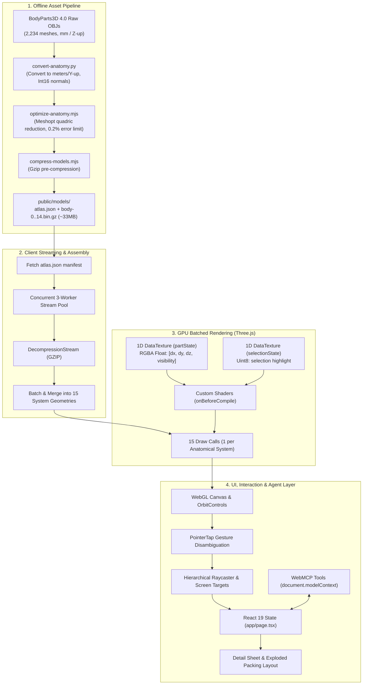
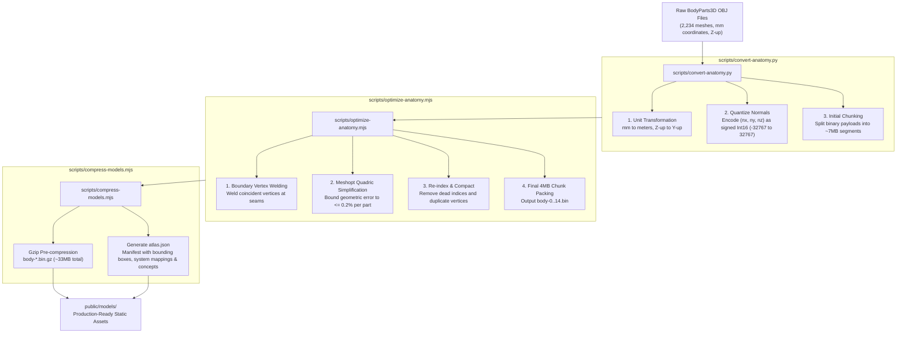
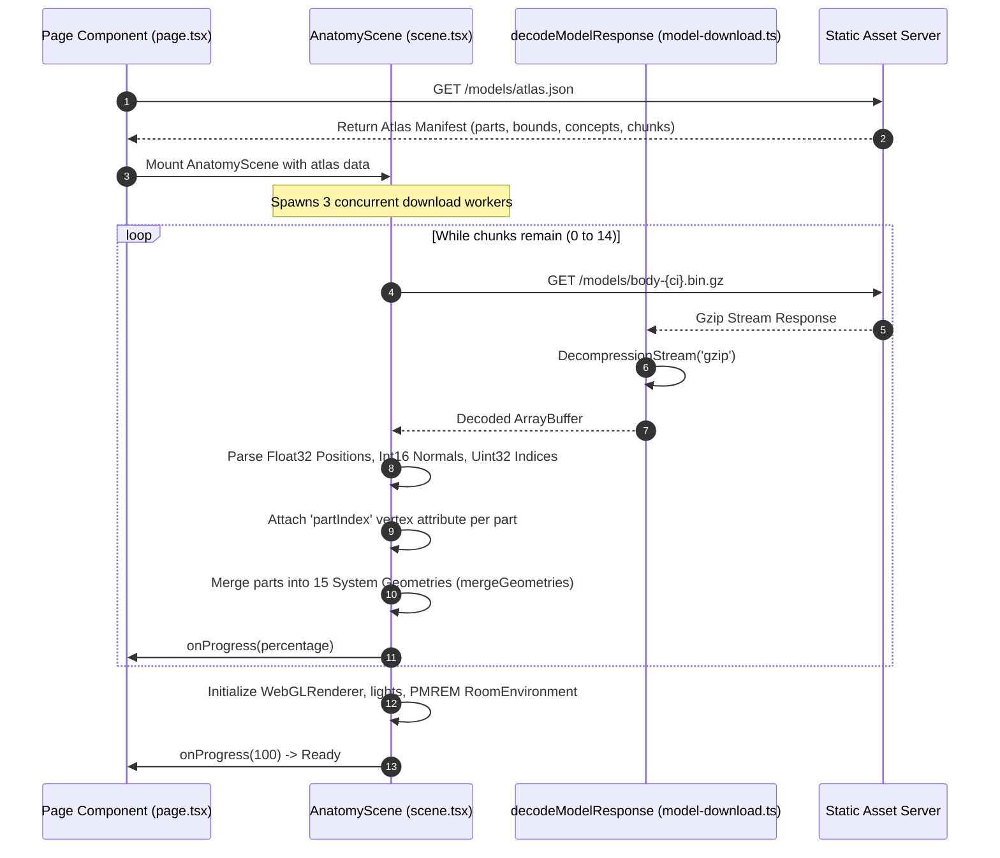
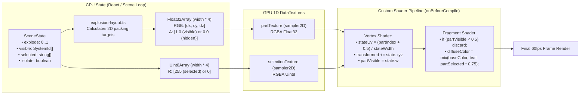
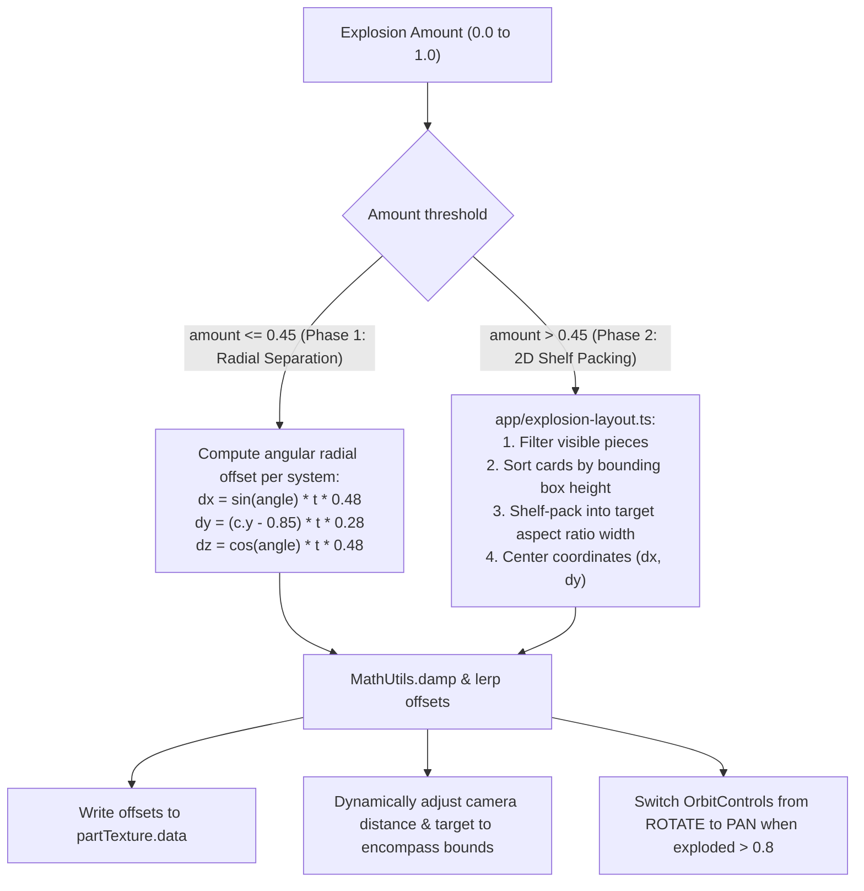
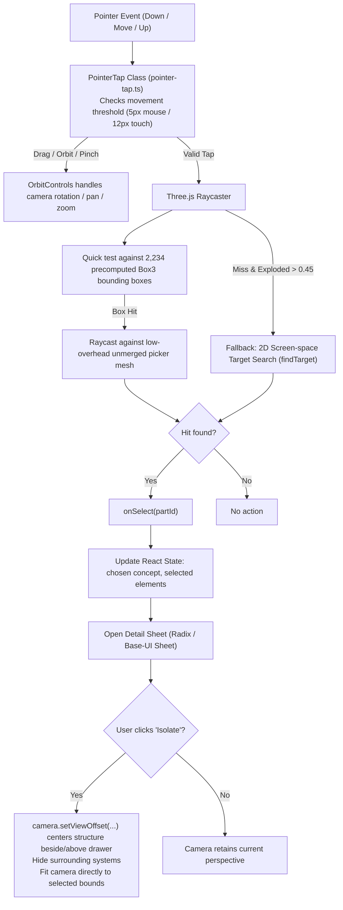
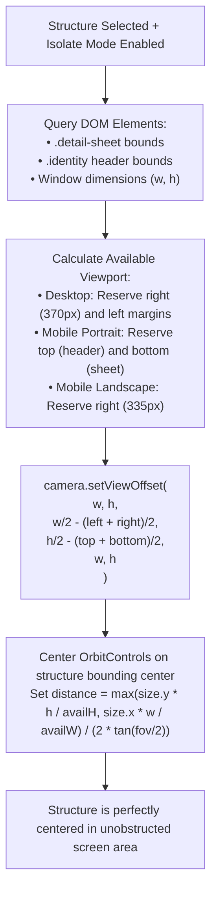
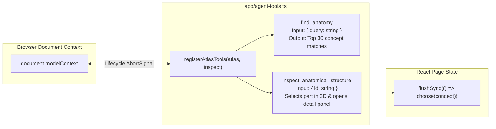

# Human Atlas — System Architecture & Technical Flowcharts

This document outlines the architectural design, data pipelines, rendering strategies, and interaction models that power the **Human Atlas** interactive 3D explorer.

---

## 1. High-Level System Architecture

The application is structured into four primary tiers:
1. **Offline Asset Pipeline**: Converts raw high-poly clinical models into simplified, web-optimized binary chunks.
2. **Streaming & Buffer Assembly**: Incrementally streams and decompresses geometry on the client without freezing the main thread.
3. **GPU Batched Rendering Engine**: Renders 2,234 parts across 15 anatomical systems using batched geometries and 1D GPU textures for real-time per-part transforms and visibility.
4. **Interactive UI & Agent Layer**: Manages user input, camera framing, raycasting, and WebMCP agentic integrations.



---

## 2. Offline Data Preprocessing Pipeline

To deliver 2,234 anatomical structures (over 2.2 million polygons) over the web, the asset preparation pipeline minimizes both file size and GPU draw calls.



---

## 3. Client Streaming & Buffer Assembly

The client loads the geometry concurrently using a pool of 3 streaming workers, decompressing GZIP streams in-flight with `DecompressionStream`.



---

## 4. GPU Batched Rendering Architecture

Rendering 2,234 separate Three.js meshes causes thousands of draw calls and degrades frame rate. Human Atlas solves this by merging all parts of each anatomical system into a single `BufferGeometry` (resulting in only 15 draw calls total).

Individual part motion and visibility are driven by **1D GPU DataTextures** sampled in custom shaders:



---

## 5. Dual-Phase Explosion & 2D Packing Algorithm

When the user adjusts the "Explode anatomy" slider ($0.0 \to 1.0$), the layout transitions smoothly through two distinct mathematical phases:



---

## 6. User Interaction, Picking & Selection Flow

Raycasting against 2.2M triangles in merged meshes every mouse move or tap is computationally prohibitive. Human Atlas separates visual meshes from invisible lightweight collision proxies:



---

## 7. Camera View Offset & Responsive Layout Math

When an anatomical structure is isolated and the inspection sheet is open, the 3D model would otherwise be occluded by floating side panels (desktop) or bottom sheets (mobile).

The camera solves this using **dynamic view offsets**:



---

## 8. WebMCP Agent Tools Architecture

Human Atlas exposes browser-level semantic inspection tools to AI subagents via standard `document.modelContext` interfaces:



---

## 9. File Structure & Component Reference

```
HumanAtlas/
├── app/
│   ├── anatomy.ts            # Type definitions, 15 system colors, educational descriptions
│   ├── scene.tsx             # Three.js scene, PMREM lighting, DataTextures, shader injection
│   ├── page.tsx              # React 19 UI shell, layer filters, search combobox, detail sheets
│   ├── explosion-layout.ts   # 2D bounding-box shelf-packing algorithm
│   ├── model-download.ts     # GZIP DecompressionStream response decoder
│   ├── pointer-tap.ts        # Gesture disambiguation (tap vs orbit/drag)
│   ├── agent-tools.ts        # WebMCP tools registration for AI agents
│   └── globals.css           # Modern glassmorphism & responsive styling
├── components/ui/            # shadcn/ui components (Sheet, Combobox, Slider, Badge, Switch)
├── public/models/
│   ├── atlas.json            # Part bounds, concepts, chunks manifest (~1.3MB)
│   └── body-0..14.bin.gz     # 15 compressed geometry chunk files (~33MB total)
└── scripts/
    ├── convert-anatomy.py    # Raw OBJ parser and unit transformer
    ├── optimize-anatomy.mjs  # Meshopt quadric simplifier
    ├── compress-models.mjs   # Gzip chunk generator
    ├── validate-atlas.mjs    # Data verification test suite
    └── validate-interactions.mjs # Interaction & packing contract test suite
```
